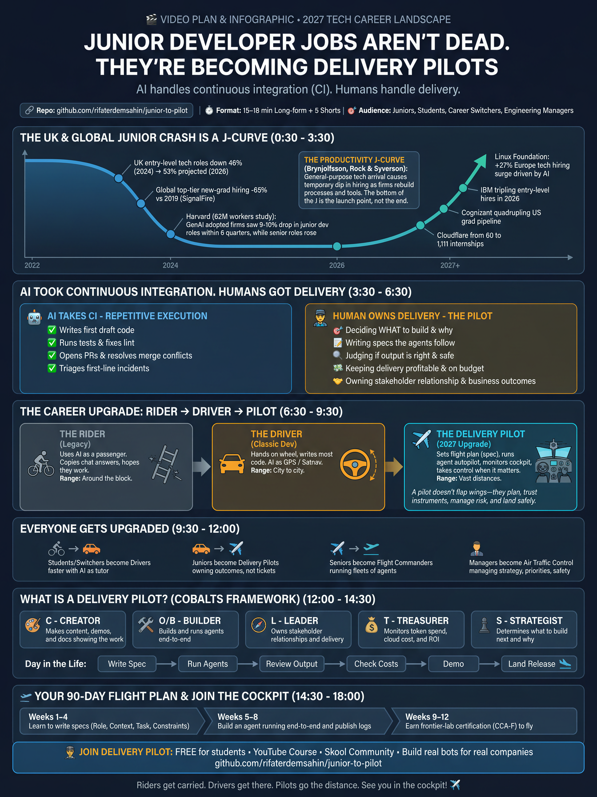

# ✈️ junior-dev-pilots

# 🎬 Video Plan: Junior Developer Jobs Aren't Dead. They're Becoming Delivery Pilots (2027)

🔗 **Repo:** [github.com/rifaterdemsahin/junior-dev-pilots](https://github.com/rifaterdemsahin/junior-dev-pilots)
🚀 **Live Interactive Player (Fly.io):** [https://junior-dev-pilots.fly.dev/](https://junior-dev-pilots.fly.dev/)
🖼️ **YouTube Thumbnails, Titles & Descriptions Kit:** [https://junior-dev-pilots.fly.dev/thumbnails.html](https://junior-dev-pilots.fly.dev/thumbnails.html)
⏱️ **Format:** Long-form, 15–18 min (~17.5 min HyperFrames composition), plus 5 Shorts cut-downs
🎯 **Audience:** Juniors, students, career switchers, and the managers hiring them
🎞️ **Production Engine:** [HyperFrames](https://hyperframes.heygen.com) (HTML + CSS + GSAP seekable timeline)



---

## 🛠️ HyperFrames Project Structure & Commands

| Path | Emoji | Description |
|---|---|---|
| `player.html` | ▶️ | Responsive web player for the HyperFrames timeline & synced audio (deployed on Fly.io) |
| `index.html` | 🎞️ | Main HyperFrames root video composition & GSAP timeline |
| `STORYBOARD.md` | 📋 | 20-frame act-by-act visual storyboard (~17.5 min) |
| `boards/` | 🖼️ | Rendered storyboard stills & visual reference boards |
| `assets/` | 🎧 | Voiceovers, audio stems, transcripts, and visual media |
| `renders/` | 🎬 | Final MP4 video exports |
| `fly.toml` / `Dockerfile` / `nginx.conf` | ☁️ | Fly.io deployment configuration for [junior-dev-pilots.fly.dev](https://junior-dev-pilots.fly.dev/) |
| `hyperframes.json` / `project.json` | ⚙️ | HyperFrames project & studio configuration |

### ⚡ Quick Commands

```bash
npm run dev       # 🖥️ Launch HyperFrames Studio preview in browser
npm run check     # ✅ Run lint, runtime, layout, motion & contrast checks
npm run render    # 🎬 Render the composition to MP4
npm run publish   # 🚀 Publish and generate a shareable link
```

---

## 🧭 Core thesis

> **AI handles continuous integration. Humans handle delivery.**

The junior role isn't dying. It's being **upgraded**. The old junior wrote code, pushed it through CI and waited for a senior to review it. Now AI writes, tests, integrates and re-runs the pipeline. The person running it moves up a level and owns **delivery**: the spec, the stakeholder, the cost and the outcome.

📉 The UK drop in junior hiring is real, but it's the **bottom of a J-curve**, not the end of the line.
🚀 Everyone in the company gets upgraded, and companies have to gather the right people and resources to stay profitable on the way up.

---

## 🏷️ Title options

1. ⭐ **Junior Developer Jobs Aren't Dead. They're Becoming Delivery Pilots (2027)**
2. Rider → Driver → Pilot: The New Tech Career Ladder for 2027
3. The UK Junior Dev Crash Is a J-Curve, and Here's the Upswing

🖼️ **Thumbnail:** "Legacy to AI Future" style. On the left, a grey 🚲 rider with a broken ladder. In the middle, a 🚗 driver. On the right, a neon ✈️ cockpit labelled **PILOT**. Draw a J-shaped arrow underneath.

---

## 🗺️ Structure

### 0:00 🪝 Hook (30s)

> "UK entry-level tech roles are down by about half. So why am I more optimistic about junior careers than I've ever been?"

Show the graph dropping, then freeze it at the low point and put a **J** shape over it.

---

### 0:30 📉 The UK numbers: the bottom of the J (3 min)

- 🇬🇧 UK entry-level technology roles fell **46% in 2024**, and projections reach **53% by the end of 2026**.
- 🌍 Globally, new-grad and entry-level hiring at the biggest tech firms is about **65% below 2019** (SignalFire 2026).
- 🧪 Harvard (62M workers): firms that adopted generative AI cut **junior** developer employment by 9–10% within six quarters, while **senior** employment kept rising.

**📈 Explain the J-curve:** When a new general-purpose technology arrives, productivity and hiring *dip first*. Companies spend on tools, rebuild processes and retrain people before the gains show up. This is the well-known **Productivity J-Curve** idea (Brynjolfsson, Rock and Syverson). We're in the dip.

**🔼 Signs of the upswing:**
- 🇪🇺 The Linux Foundation reports a **27% tech hiring surge in Europe** driven by AI, even as traditional junior roles shrink.
- 🏢 IBM says it's tripling entry-level hires in 2026, Cognizant is quadrupling its US graduate pipeline, and Cloudflare went from about 60 internships to 1,111. *(Disclose that you work at IBM.)*

🎙️ **Line to say:** "The bottom of the J feels like the end. It's actually the launch point."

---

### 3:30 🤖 AI took continuous integration. Humans got delivery (3 min)

What AI now does well 🔁:
- ✅ Writes the first draft of code
- ✅ Runs tests, fixes lint, re-runs the pipeline
- ✅ Opens PRs, resolves simple merge conflicts
- ✅ Triages first-line incidents

What stays human 🧑‍✈️:
- 🎯 Deciding *what* to build and *why*
- 📝 Writing the spec the agents follow
- 🔍 Judging whether the output is actually right
- 💷 Keeping delivery profitable
- 🤝 Owning the relationship with the stakeholder

🎙️ **Line to say:** "CI became AI's job. Delivery became yours."

Use one of your OBP or SRE onboarding stories here. The pipeline was never the hard part. Getting a market participant live, safely, on time was.

---

### 6:30 🚲 ➡️ 🚗 ➡️ ✈️ The Rider → Driver → Pilot analogy (3 min)

| Level | Who | How they work with AI | Range |
|---|---|---|---|
| 🚲 **Rider** | Uses AI like a passenger | Copies answers from a chatbot and hopes they work | Around the block |
| 🚗 **Driver** | Classic developer | Hands on the wheel and writes most of the code; AI is the satnav | City to city |
| ✈️ **Pilot** | **Delivery Pilot** | Sets the flight plan (spec), runs agents on autopilot, watches the instruments, takes control when it matters | 🌍 **Vast distances** |

🎙️ **Key point:** A pilot doesn't flap the wings. A pilot **plans the route, trusts the instruments, watches for risk and lands safely.** That's why pilots cover distances no driver can. One Delivery Pilot can deliver what used to take a whole team.

---

### 9:30 🆙 Everyone got upgraded (2.5 min)

This is the **hope** section. Nobody gets demoted. Everyone moves up a seat:

- 🚲 → 🚗 **Students and career switchers** become drivers faster than ever, because AI is a patient tutor.
- 🚗 → ✈️ **Juniors** become **Delivery Pilots**: they own outcomes, not tickets.
- ✈️ → 🛫 **Seniors** become flight commanders, running fleets of pilots and agents.
- 🧑‍💼 **Managers** become air traffic control: strategy, priorities, safety.

💷 **The business reality:** To stay profitable through the J-curve, companies have to **gather resources**: the right people, the right agent tooling and the right skills. The companies that keep investing in pilots now will own the upswing. The ones that freeze will face a senior shortage around 2031, because today's juniors are tomorrow's seniors.

---

### 12:00 🧑‍✈️ What is a Delivery Pilot? COBALTS (2.5 min)

| Letter | Role | What it looks like day to day |
|---|---|---|
| 🎨 **C** | Creator | Makes content, demos and docs that show the work |
| 🛠️ **O/B** | Builder | Builds and runs agents end to end |
| 🧭 **L** | Leader | Owns the stakeholder and the delivery |
| 💰 **T** | Treasurer | Watches token spend, cloud cost and ROI |
| ♟️ **S** | Strategist | Picks what to build next and why |

📅 **A day in the life:** ☕ write the spec → 🤖 send it to agents → 🔍 review the output → 💷 check costs → 🤝 demo to the stakeholder → 🛬 land the release.

---

### 14:30 🛫 Your 90-day flight plan (2 min)

1. 📝 **Weeks 1–4:** Learn to write specs, not just code (Module 1.1: Role, Context, Task, Constraints).
2. 🤖 **Weeks 5–8:** Build one agent that runs end to end and publish its logs.
3. 🏅 **Weeks 9–12:** Get a frontier-lab certification such as **CCA-F** as proof you can fly.

---

### 16:30 📣 CTA: join Delivery Pilot (1 min)

🧑‍✈️ **Delivery Pilot** is where you train to become one:
- 🎓 **Free for students.** If you're studying, your seat in the cockpit costs nothing.
- 📺 The full course is free on YouTube.
- 🏠 The **Skool room** is where we build, review and certify together.
- 🏢 Certified pilots go on to build real bots for real companies.

🎙️ **Closing line:** "Riders get carried. Drivers get there. **Pilots go the distance.** See you in the cockpit. ✈️"

🔗 Link in description: [github.com/rifaterdemsahin/junior-dev-pilots](https://github.com/rifaterdemsahin/junior-dev-pilots)

---

## 📱 Shorts cut-downs (45s each)

1. 📉 "UK junior jobs are down by half, and that's the bottom of a J-curve"
2. 🤖 "AI took CI. You get delivery."
3. 🚲🚗✈️ "Rider, driver or pilot: which one are you?"
4. 🆙 "Nobody got replaced. Everyone got upgraded."
5. 🎓 "Delivery Pilot is free for students. Here's why."

---

## ⚠️ Notes before filming

- 🏷️ **"Delivery Pilot" is your own framing**, not a job title employers post yet. Say "this is what I'm calling it" on screen, so the 2027 claim reads as an evidence-based prediction.
- 📈 **Frame the J-curve as a model, not a promise.** The dip is measured. The upswing is the bet. Say that honestly; it makes the hope more credible, not less.
- ⚖️ **Honesty beat:** LinkedIn's Economic Graph team found that interest rates explain most of the swings in software hiring over the past decade, and it's unclear how much of the current drop is AI. One sentence on this builds trust.
- 🔎 Several headline figures come from blog posts quoting other reports. Check the originals before putting numbers on screen.
- 🏢 Disclose your IBM role when you mention IBM's hiring.

---

## 📚 Sources to verify

- SignalFire, *2026 State of Tech Talent* report
- Stanford Digital Economy Lab: early-career employment in AI-exposed jobs
- Harvard study of 62M workers across 285k US firms (junior vs senior hiring after GenAI adoption)
- LinkedIn Economic Graph, *U.S. Software Engineer Talent Landscape* (Feb 2026)
- Linux Foundation European tech hiring report, via The New Stack (Jun 2026)
- UK entry-level tech decline figures (46% in 2024, 53% projected for 2026), via DEV Community: trace to the original UK source
- Brynjolfsson, Rock & Syverson, *The Productivity J-Curve*
